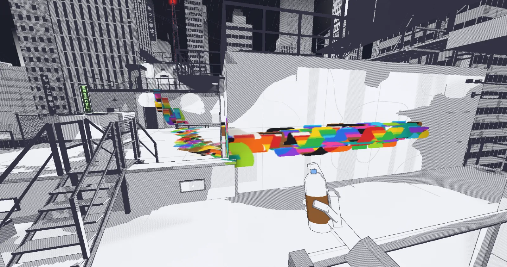

<p align="center">
  <picture>
    <source media="(prefers-color-scheme: dark)" srcset="docs/img/logo-paper.png">
    
  </picture>
</p>

<p align="center">A graffiti game in your browser · <a href="https://roof.hidden.haus"><b>Play at roof.hidden.haus</b></a></p>

<p align="center"></p>

Hidden Roof is a first-person graffiti game. You climb onto the rooftops of a city drawn in ink, where the only color is the paint you bring. There are no enemies and no goals: paint whatever you like, scrub it off, paint again.

## The game

- **Tools:** a spray can with four caps, a marker, a stepladder, a paint roller and a sponge. You start with the can and black; the other twelve colors, the caps and the tools are hidden around the roof.
- **Multiplayer:** host a session from the menu and share its five-letter code. Up to 20 players paint the same roof.
- **Inspired by** [Bombing!!: A Graffiti Sandbox and Bombing!! 2](https://store.steampowered.com/app/1527520/), [Marc Eckō's Getting Up: Contents Under Pressure](https://store.steampowered.com/app/260190/) and Daisuke Tajima's [*Beyond the Lines*](https://www.seigensha.com/books/978-4-86152-902-3/).

## How it's built

three.js, TypeScript and Vite, with no asset files: geometry, textures and sounds are made in code. The first rule: painting the whole level costs the same per frame as painting nothing.

- **Paint** is baked into textures shared by many surfaces, at one density everywhere; only the changed part of a texture is uploaded.
- **Ink:** each pixel's tone picks paper, hatching, cross-hatching or black; pen outlines come from the depth buffer.
- **Light** from lamps is baked with shadows; only the moving CCTV lights are real-time.
- **Multiplayer** is one Node server with `ws`, state in memory only.

| Path | What |
|---|---|
| `src/kit` | Props as simple pieces: meshes, colliders, ladders and paintable faces |
| `src/level` | Levels: pieces into meshes, colliders and draw batches |
| `src/render`, `src/city` | The ink look, baked light, the generated city |
| `src/net`, `server/` | Multiplayer client and server |
| `src/config.ts` | Every tunable number |
| `public/levels` | Levels as JSON |

## Getting started

Requires Node 20.19+ or 22.12+.

```sh
git clone https://github.com/GeoGeorgeous/hidden-roof.git
cd hidden-roof
npm install
npm run dev
```

The game opens at `http://localhost:5173`, with the dev tools (F3). To play together locally, run `npm run server` in a second terminal and open the game in two windows side by side, one of them incognito: a background tab draws nothing.

## Commands

**Develop**

| Command | What |
|---|---|
| `npm run dev` | The game with dev tools at `localhost:5173`; `/ws` goes to the local server |
| `npm run server` | Builds and starts the multiplayer server on port 3000 |
| `npm run build` | The player build in `dist/`, what is deployed |
| `npm run build:dev` | The build with dev tools in `dist-dev/` |
| `npm run build:server` | The server as one file in `dist-server/` |
| `npm run preview` | Serves the last build at `localhost:4173` |
| `npm run typecheck` | Types of the game and the server |

**Check**

| Command | What | Time |
|---|---|---|
| `npm run check:quick` | Build, unit tests and unused code: after every change | ~5 s |
| `npm run check` | Everything below, golden paint last: before a merge | ~5 min |
| `npm test` | Unit tests in Node | <1 s |
| `npm run audit` | Unused code (knip) and duplicates (jscpd) | |

**Tests in the browser** (one at a time)

| Command | What | Time |
|---|---|---|
| `npm run smoke` | The level loads and plays without errors | ~8 s |
| `npm run test:boot` | The loading screen explains why the game can't start | ~2 s |
| `npm run test:game` | Game behavior: menus, tools, paint, input, hints | ~140 s |
| `npm run test:server` | The server against games speaking the protocol | ~8 s |
| `npm run test:mp` | Two players in two pages: host, join, save, reconnect | ~35 s |
| `npm run test:csp` | The game under the site's Content Security Policy | ~6 s |
| `npm run golden` | Paint at every detail level against a stored baseline | ~50 s |
| `npm run test:weak-link` | Multiplayer on weak networks (not in `check`) | ~8 min |

**Looks and performance** (on the real GPU)

| Command | What |
|---|---|
| `npm run shots` | Screenshots of the real game in `shots/` |
| `npm run shots:avatar` | Every avatar pose and a contact sheet |
| `npm run bench` | Frame cost, to compare builds or GPUs |
| `npm run bench:save` | Save size and save/load time (after `npm run golden`) |
| `npm run bench:join` | A join into a painted roof: download, load, memory |

What each test covers and how to read a failure: [docs/testing.md](docs/testing.md). Hosting: [docs/deploy.md](docs/deploy.md).
